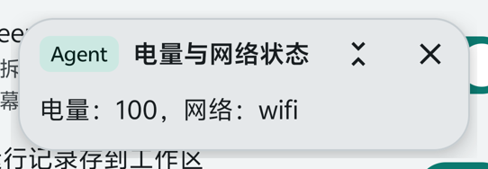
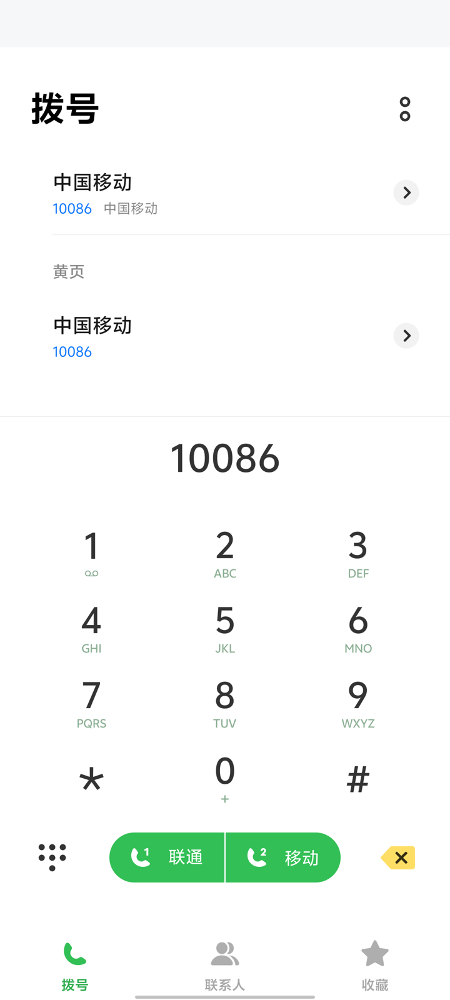
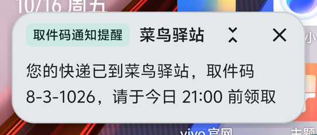
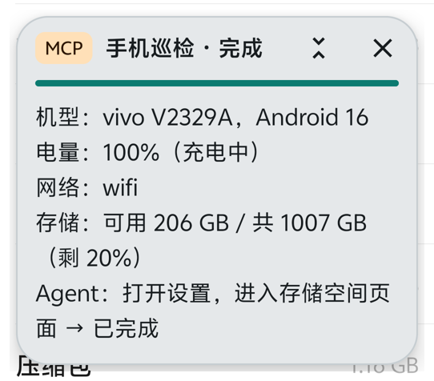
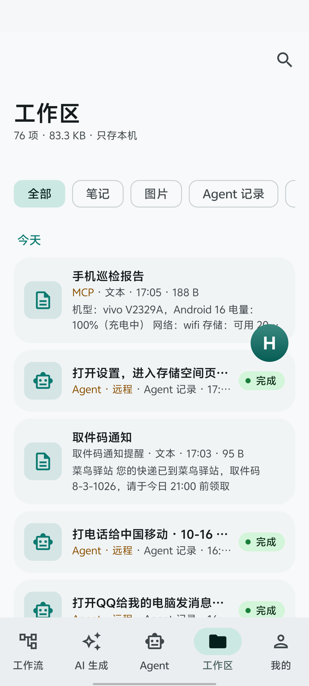

# Habitat 项目介绍

> 让 AI 直接操作安卓手机：一句话下达任务，手机自己点、自己查、自己核对，结果实时显示、自动留档。

## 一页看懂

| | |
|---|---|
| **是什么** | 一套跑在安卓手机上的自动化引擎 + App。AI（DeepSeek / TypeSafe Jev / 本地规则）规划任务、逐屏决定点哪里，代码负责执行、校验和安全拦截。 |
| **解决什么** | 手机上大量重复操作（查信息、改设置、发消息、处理通知、按条件执行一串动作）只能人工点；普通脚本录制遇到界面变化就失效，纯大模型直接点屏幕又慢又不可控。 |
| **怎么用** | ① 在 App 里说一句话交给 Agent；② 用一句话让 AI 生成可重复运行的「工作流」，可挂触发条件（收到通知、定时、剪贴板…）；③ 电脑上的 AI（Claude、Cursor 或自研 Agent）通过 MCP 协议远程调用手机能力。 |
| **成熟度** | 真机独立评测（vivo / Android 16，结果用 adb 读屏核对，不信 AI 自报）：12 类任务、开规划时 Jev、DeepSeek 两种执行器都是 **12/12**（2026-10-16；不开规划 9/12、11/12）；169 条单元测试、70 条真机自测；GitHub 开源（MIT），可作为库嵌入其它 App。 |
| **数据** | 结果只存手机本机；开规划/云端执行器时屏幕文字会发给对应模型服务，选「本地」执行器可完全离线。 |

## 典型场景（真机实测）

以下示例都在同一台手机（vivo V2329A / Android 16）上实际运行（2026-10-16），耗时为从下达到核对完成的总时间。

### 1. 一句话查状态，结果显示在屏幕上

> 在 Agent 页输入：**查一下电量和网络状态，显示在小屏上**

- 规划器拆成 3 步：读电量 → 读网络 → 显示到小屏，全部走系统接口，不需要在界面里翻。
- 用时约 **7 秒**，小屏显示「电量：100，网络：wifi」，复核环节确认小屏已显示后结束；运行记录自动进工作区。
- 价值：值班、巡检、出差时一句话拿到状态，不用打开多个设置页。



### 2. 远程让手机发消息：填好，由人确认发送

> 电脑通过 MCP 发起：**打开QQ给我的电脑发消息说：今天下午三点的会改到四点**

- 识别为「发消息」意图，对象「我的电脑」、内容「今天下午三点的会改到四点」，直接走固定做法：打开 QQ → 进入会话 → 输入。
- 用时约 **10 秒**，3 步。因为是远程发起，**只填好消息、不点发送**，提示「请在手机上确认后点发送」。在手机上本人发起同样的话则会直接发出。
- 价值：AI 帮忙准备消息，发不发由人决定，避免 AI 代发出错。

### 3. 按名字打电话：号码只在手机上查

> 电脑通过 MCP 发起：**打电话给中国移动**

- 识别为「打电话」，号码 10086 在手机本机查出（目标里的号码 → 通讯录 → 内置客服号码表），**不发给任何模型**。
- 用时约 **2.7 秒**，1 步：打开拨号盘并填好号码。远程发起不自动拨出，由人按拨号键。



### 4. 一句话生成「自动处理通知」的工作流

> 在「AI 生成」页输入：**收到内容包含"取件码"的通知时，把通知标题和内容显示在悬浮小屏上（30秒后自动隐藏），同时记到工作区，标签为取件码**

- DeepSeek 约 **6 秒**生成工作流（通知触发器 + 3 个节点）：通知触发 → 判断是否含「取件码」→ 小屏显示 30 秒 → 写进工作区。结构检查通过，保存后在「工作流」页打开开关即开始监听。
- 模拟一条快递通知「您的快递已到菜鸟驿站，取件码 8-3-1026…」：**1.2 秒**后小屏弹出取件码，同时在工作区留下一条带「取件码」标签的记录；一条无关的日历通知不会触发。
- 价值：业务人员不写代码，用一句话就能做出长期运行的自动化（验证码、快递、告警通知、短信）。



<details>
<summary>生成的工作流（JSON）</summary>

```json
{
  "trigger": { "type": "notification" },
  "start_node_id": "s1",
  "nodes": {
    "s1": { "id": "s1", "type": "CONDITION_SWITCH", "params": { "expression": "trigger_text contains 取件码" }, "branches": { "true": "s2" } },
    "s2": { "id": "s2", "type": "ACTION_MINI_SCREEN", "params": { "title": "${trigger_title}", "text": "${trigger_text}", "duration_ms": 30000 }, "next": "s3" },
    "s3": { "id": "s3", "type": "ACTION_WORKSPACE", "params": { "action": "write", "name": "取件码通知", "content": "${trigger_title}\n${trigger_text}", "tags": "取件码" } }
  }
}
```
</details>

### 5. 电脑端 AI 编排手机：边做边在手机上汇报

> 电脑运行 `node scripts/demo_mcp_orchestrate.mjs`（模拟 Claude / Cursor 等 AI 客户端）

- 通过 MCP 依次：在手机小屏上显示「手机巡检」→ 直接读取机型、电量、网络、存储 → 把「打开设置，进入存储空间页面」交给手机 Agent 去界面里完成 → 汇总结果显示在小屏、写入手机工作区。
- 全程约 **8.5 秒**（其中 Agent 进存储页约 8 秒），手机最终停在存储空间页面。
- 远程写入的小屏内容固定标「MCP」并用警示色，和本机内容一眼区分。
- 价值：手机变成 AI 可以调用的「执行端」——电脑上的 AI 负责想，手机负责做并实时反馈。



### 工作区：所有结果自动留档

每次 Agent 任务、打开了记录的工作流、AI「记下来」的内容都按时间进入工作区，可搜索、置顶、分享；远程来源标「Agent · 远程」「MCP」。



> 跑示例的过程中发现并修复了两个问题：①「发消息说：……」里的冒号被当成了消息内容；② AI 生成工作流时不知道触发器提供的变量名（会编出 `notification_text`），导致生成的工作流不会自动触发。修复后才得到上面的结果。

## 核心能力

**1. 一句话自主完成（Agent）**
- 先由 DeepSeek 把目标拆成 1~6 步，每步写清「屏幕上看到什么算完成」。
- 能直接调系统能力的（打开设置某页、开关蓝牙/WLAN、调亮度音量、读电量/版本/网络、拨号）直接调，不在界面里翻找。
- 需要点界面的，由执行器在**代码生成的候选**里选一个（不让模型自己编坐标），代码执行后再读屏核对；卡住会从当前屏幕重新规划。
- 最后由复核环节按屏幕证据判断是否真的完成，提问类目标在这里读出答案。

**2. 工作流：AI 生成、可重复运行**
- 一句话 → DeepSeek 生成工作流（扁平 JSON），可视化结构图查看、编辑、保存。
- 86 种节点：界面操作、系统设置、通话短信、网络请求、文件/数据库、传感器、本地 AI、悬浮小屏、工作区等。
- 触发方式：手动、悬浮球一键、收到通知、收到短信、定时、剪贴板变化、按键。

**3. 实时反馈：悬浮小屏**
- 任务进行中在屏幕上方显示文字、图片、进度；可拖动、折叠、关闭。
- AI 点屏幕时小屏会自动让开，截图时自动隐藏，不干扰任务。

**4. 结果留档：AI 工作区**
- Agent 每次任务的目标、每一步、结果、耗时自动存档；工作流可选择把运行结果存档；AI 可以主动「记下来」。
- 在 App 底部「工作区」按天查看、搜索、置顶、分享。只存本机。

**5. 开放接入：手机上的 MCP 服务**
- 标准 MCP 协议，电脑上的任意 AI 客户端可读屏、调用全部节点、启动 Agent 任务、往小屏推送内容。
- 默认只允许本机（经 USB 转发）访问，每台手机随机令牌；高危能力（Shell、文件、短信、通话等）远程默认关闭。

## 架构

```
            ┌──────────── 手机 ─────────────────────────────────────────────┐
 用户一句话 ─┤  规划（DeepSeek）：拆步骤 + 完成条件         复核：按屏幕判断是否完成  │
            │        │                                         ▲          │
            │        ▼                                         │          │
            │  每一步 ─ 设备工具（直接调系统能力）──────────────────┤          │
            │        └ 界面步：读屏 → 代码生成候选 → 执行器选一个 → 代码执行 → 再读屏
            │                         （Jev / DeepSeek / 本地）              │
            │                                                              │
            │  引擎 :lib —— 86 种节点 · 工作流执行器 · 触发器 · 安全闸        │
            │  App  :app —— 界面 · 无障碍服务 · 小屏 · 工作区 · MCP 服务      │
            └──────────────────────────────────────────────────────────────┘
                     ▲ MCP（ws://127.0.0.1:8931/mcp，令牌鉴权）
                     │
              电脑上的 AI 客户端 / 自动化脚本
```

**关键设计**：大模型只做「拆步骤」和「在给定选项里选一个」，进度推进、导航记忆、判重、换招、安全拦截全部由代码掌握。这样既用上了模型的理解能力，又避免了模型自由发挥带来的误操作。

## 安全与数据

- **敏感操作默认拦截**：支付、转账、删除、卸载、重置、授权等按钮默认不出现在候选里，只有用户本人在手机上发起、且目标原文里写了同一个词才放行；远程发起的任务一律不能解锁。支付密码、指纹验证页不给任何点击和输入。
- **远程任务只填不发**：通过 MCP 远程发起的「发消息」只把消息填好，「打电话」只填好拨号盘，最后一步由人确认。
- **模型输出不可信**：规划器给的工具和参数要过白名单；要输入的文字必须是用户原话的一部分，不能编造。
- **号码不出手机**：打电话时号码在本机查（目标里的号码 → 通讯录 → 内置客服号码），不发给任何模型。
- **数据去向**：开规划时目标和屏幕文字发给 DeepSeek；执行器选 Jev 时发给 TypeSafe；选「本地」且不开规划时完全不联网。运行记录、笔记只存在手机 `filesDir/workspace`，没有任何上传通道。
- **密钥加密存储**（Android EncryptedSharedPreferences），不进日志。

## 安装与使用

**安装**
1. 安装 `app-standard-arm64-v8a-release.apk`（Android 10 及以上）。
2. 打开 App，按提示开启「无障碍服务」（读屏和点击必需）。
3. 「Agent」页填入 DeepSeek API Key（规划和复核用）；需要 Jev 时再填 Jev Key。国内网络访问 Jev 需要代理。

**一句话任务**：底栏「Agent」→ 输入目标（如「查一下现在电量，显示在小屏上」）→ 开始。步骤实时显示在页面下方，结束后在「工作区」能看到完整记录。

**生成工作流**：底栏「AI 生成」→ 描述需求（如「收到包含取件码的通知时，显示在小屏上并记到工作区」）→ 生成 → 检查结构图 → 保存。在「工作流」页打开开关即开始监听；需要留档的，在编辑器里打开「运行结果存到工作区」。

**电脑接入（MCP）**
```bash
adb forward tcp:8931 tcp:8931
# MCP 地址：ws://127.0.0.1:8931/mcp   令牌：App「Agent」页复制
node scripts/mcp_call.mjs agent_start '{"goal":"打开设置，进入蓝牙页面"}'
```

## 当前局限

- 只在一台 vivo（Android 16）上做过系统评测，其它品牌/系统界面差异需要逐步适配。
- 评测任务偏短（设置导航、提问、开关、发消息、打电话），长链路、跨多个 App 的复杂任务还需更多验证。
- 依赖第三方模型服务（DeepSeek、TypeSafe），可用性和效果随服务变化；国内访问 Jev 需代理。
- 需要开启无障碍服务；部分能力（Shell、截图）需要 Shizuku。
- 微信读屏只在自用渠道包里提供，不能对外分发。

## 下一步

- 扩大评测：更多机型、更长的多 App 任务、每项多次重复取稳定性。
- 常用场景做成「固定做法」：识别到意图后按代码写好的步骤执行，速度更快、结果更稳定（已用于打电话、发消息）。
- 工作区内容可被后续任务引用（例如「把昨天记下的取件码发给我」），并支持导出。
- 工作流市场：把验证过的工作流打包分享。

## 附：项目数据

| | |
|---|---|
| 代码 | Kotlin，约 3.1 万行（引擎 `:lib` + App `:app`） |
| 节点 | 86 种 |
| 测试 | 169 条单元测试（JVM）、70 条真机自测、12 项 Agent 真机评测任务 |
| 评测记录 | [docs/EVAL.md](EVAL.md)（方法、原始数据、局限） |
| 版本 | App 1.10.0 · 引擎 1.9.0（JitPack：`com.github.Allenwang0730:HabitatEngine`） |
| 开源 | <https://github.com/Allenwang0730/HabitatEngine>（MIT） |
